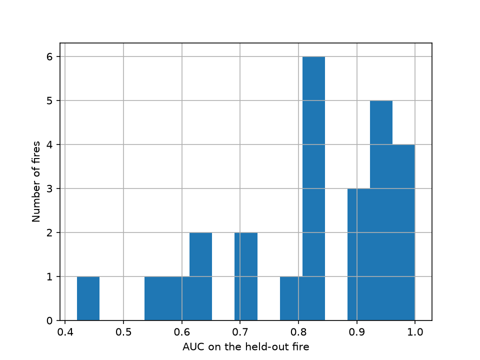

# debris-flow-reproduction
Can I reproduce the USGS M1 debris-flow likelihood model for Southern California, and can other models predict new fires better?

October 27, 2026:
All 115 rows dropped for missing rainfall had no debris flow, and 108 of them are from one fire (Coal Seam). Dropping them raised the debris-flow share in your subset from 23% to 25%, which pushes the intercept up. But that’s a small shift, so it explains only a sliver of the gap between -2.03 and -3.63. Something bigger is different, and haven’t found it yet.
Fix:USGS built M1 only from southern California fires: 939 records from 19 fires, 201 of them debris flows. The other states (Colorado, Arizona, New Mexico, Montana, Utah) were held out as a separate test set. My fits earlier mixed both groups. Your first fit used all 1,320 rows, which includes the Colorado fire with 253 records (Coal Seam) and the other test fires, so it wasn’t the same experiment. The report’s Table 3 says the 15-minute model used 815 training records, which is very close to the 817 or so California rows you should have in the 2016 subset.

The five reading questions, answered from the report:

What it predicts: the probability of a debris flow in a burned basin for a given storm, valid for one to two years after a fire.
Inputs: peak rainfall over 15, 30 or 60 minutes, multiplied by T (the proportion of the upslope area with moderate to high burn severity and slope of 23° or more), F (dNBR divided by 1,000) and S (soil KF-factor).
Data: 1,550 records in total, with rain gauges within 4 km, storms separated by at least 8 dry hours, burn severity from field-checked agency maps, 10 m elevation data, and USGS soil data.
How they judged it: a threat score, TP / (TP + FN + FP), and Tjur R². The 15-minute model won, with a threat score of 0.42 on training and 0.39 on test, and Tjur R² of 0.34 and 0.33.
Limits: not for unburned areas, and not where debris flows usually come from shallow landslides.

## Results: reproducing the USGS M1 model

**What I did.** I fit the USGS M1 logistic regression (15-minute rainfall version) to the 817 southern California rows from the 2016 inventory, using the new USGS debris-flow inventory. I then tested it on the 503 rows from other western states, which is how USGS built and tested the model.

| | B | Ct | Cf | Cs |
| --- | --- | --- | --- | --- |
| Published (Staley et al., 2016) | -3.63 | 0.41 | 0.67 | 0.70 |
| Mine (southern California rows, n = 817) | -3.64 | 0.41 | 0.66 | 0.71 |

**What matched.** My coefficients are within 0.01 of the published ones. The debris-flow counts match the report: 201 in training and 133 in testing. Tjur R² on training is 0.34, the same as the report, and on the test set it is 0.32 against the report's 0.33.

**What didn't match at first.** My first fit used all 1,320 rows from the 2016 inventory, from southern California and other states combined, and gave an intercept of -2.03 and coefficients of 0.31, -0.07 and 0.09, far from the published values. USGS built M1 from southern California fires and kept fires from other states for testing, so mixing them pulled my coefficients away from the published ones. When I refit on southern California rows only, I matched the published coefficients to within 0.01.

**Small differences that remain.** I have 817 training rows against the report's 815, because the inventory has been corrected and reformatted since 2016. My test set has 503 rows, while the report's Table 3 lists 428 for the 15-minute model. I haven't traced why yet.

**Next.** Leave-one-fire-out testing, which holds out one whole fire at a time to see how the model does on a fire it has never seen.

**Leave-one-fire-out results.** Holding out one whole fire at a time, the median AUC was [__] across [N] fires (all states) and [__] across [N] fires (California only). Most fires scored between 0.8 and 1.0, but [number] scored below 0.65, and the lowest was [fire name] at [__]. [Fire name] had only [n] rows and [n] debris flows, so [say whether you trust that score, and why].

## Results: testing on fires the model has never seen

To check how M1 does on a new fire, I used leave-one-fire-out validation. For each fire, I trained the model on all the other fires and scored it on the one left out. I only scored fires with at least 30 rows and both outcomes (debris flow and no debris flow), since AUC can't be computed otherwise.

- **Median AUC, all states:** 0.84 across 26 fires.
- **Median AUC, California only:** 0.89 across 9 fires.
- **Spread:** 18 of the 26 fires scored 0.8 or higher, and 4 scored below 0.65. The lowest was Cameron Peak (Colorado) at 0.42, with 30 rows and 20 debris flows. Little Bear (New Mexico) scored 0.56 and East Troublesome (Colorado) 0.59.

**What this means.** An AUC of 0.5 is a coin flip and 1.0 is perfect. The model ranks most new fires well, but its score varies a lot from fire to fire. The low scores are not limited to one region. Some of the highest scores come from fires with very few debris flows (Witch has 1, Flag has 2, Briceburg and Gladiator have 3), so scores near 1.0 on those fires are not reliable. The median is a safer summary than any single fire. This test holds out one fire at a time, so other fires from the same region are still in training. My earlier check, training on southern California and testing on other states, is the harder test of new regions.
